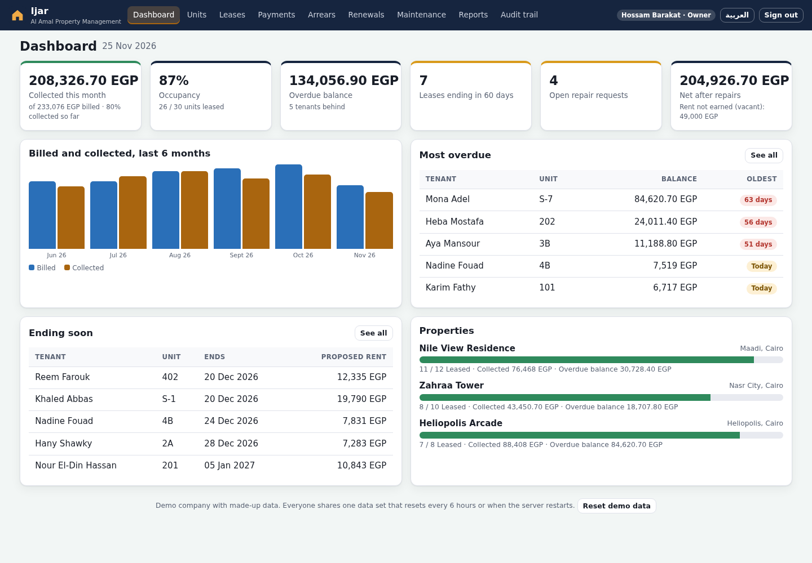
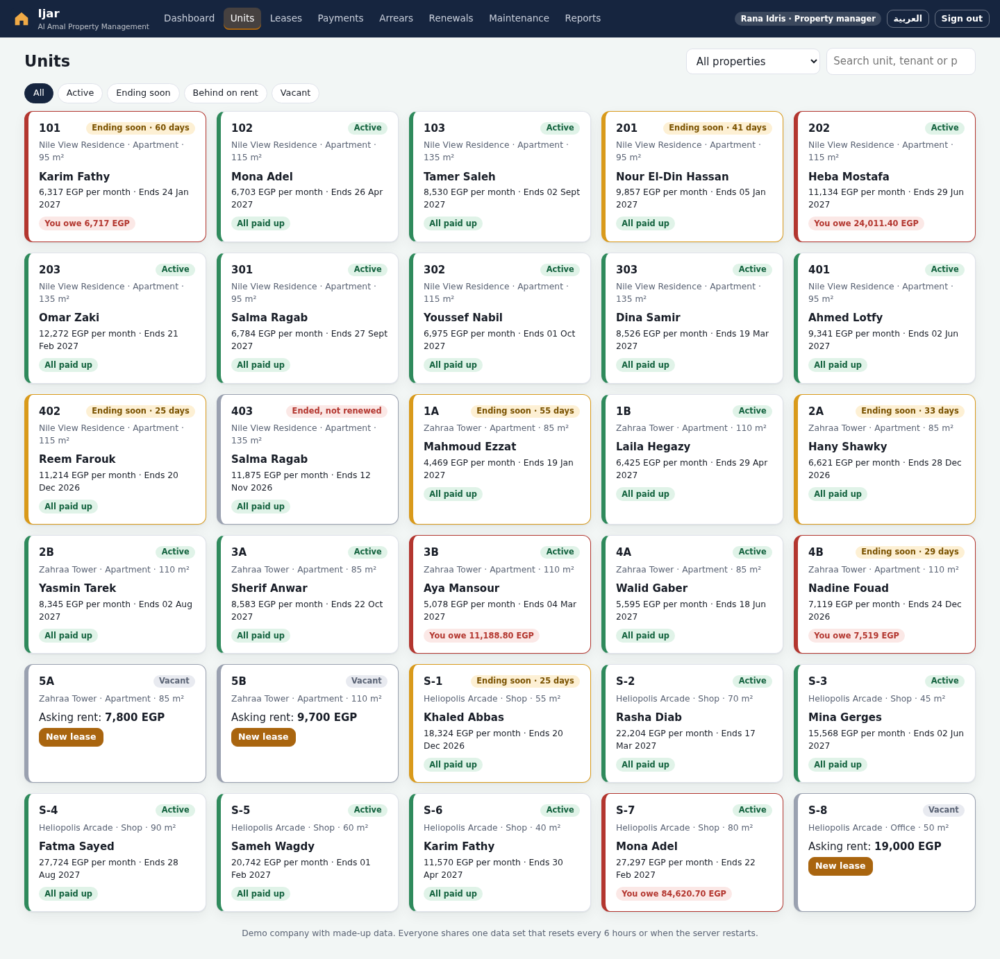
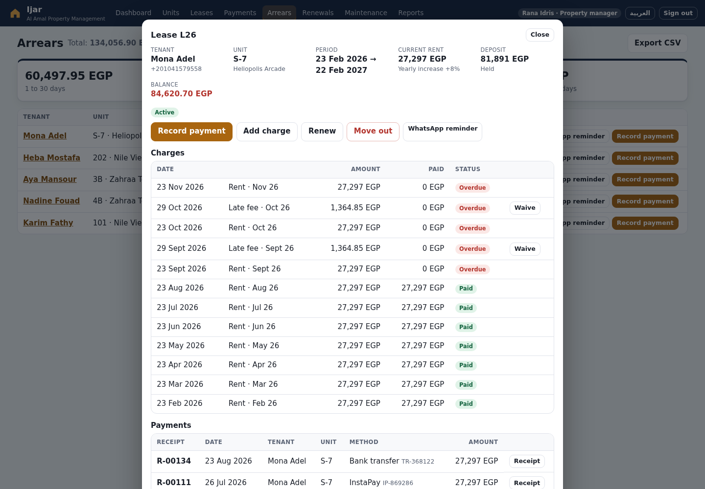
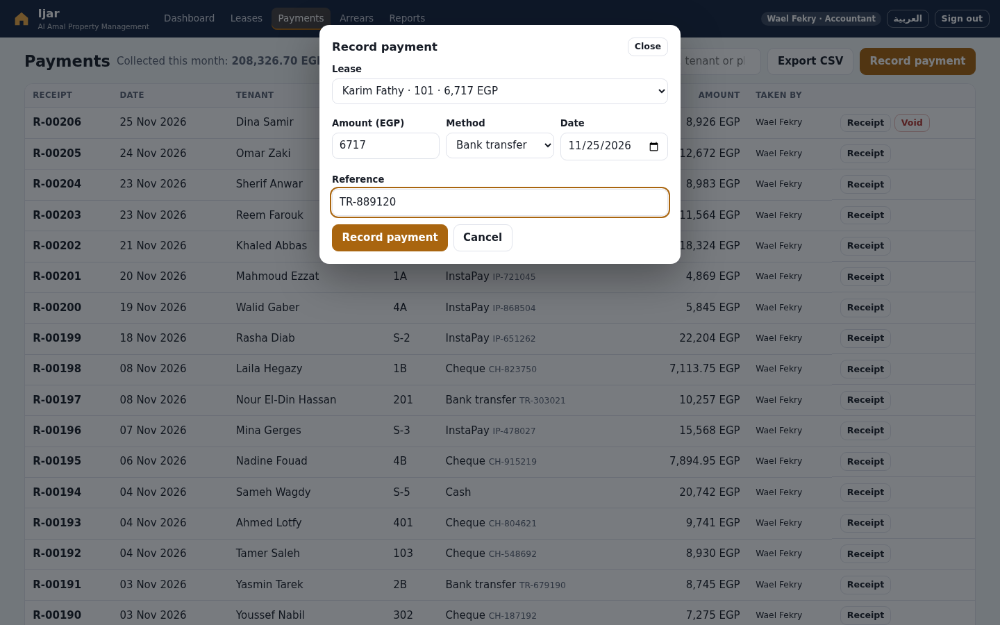
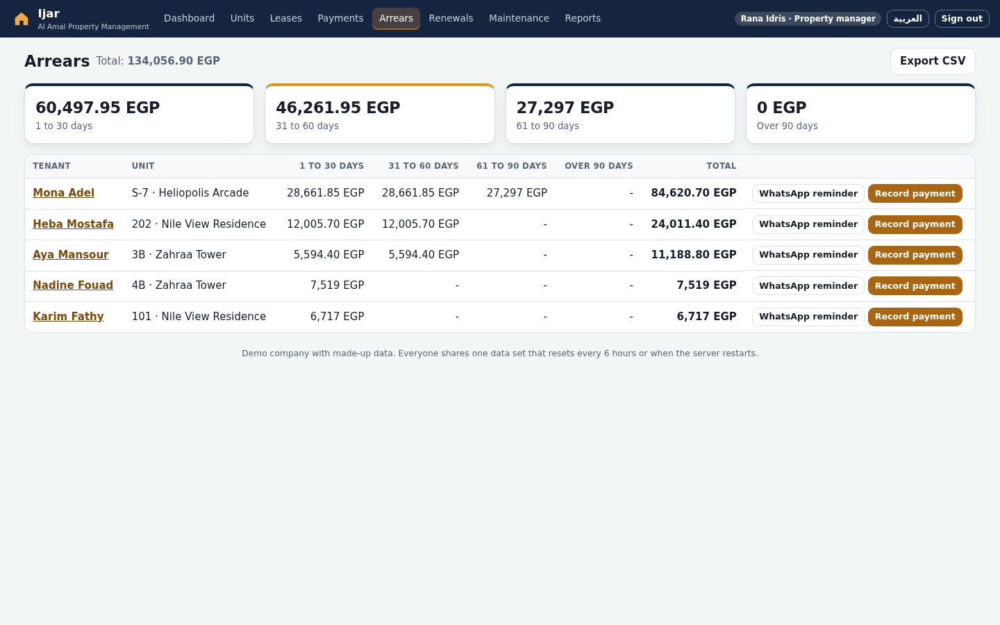
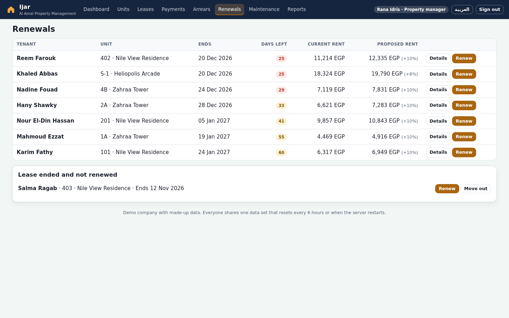
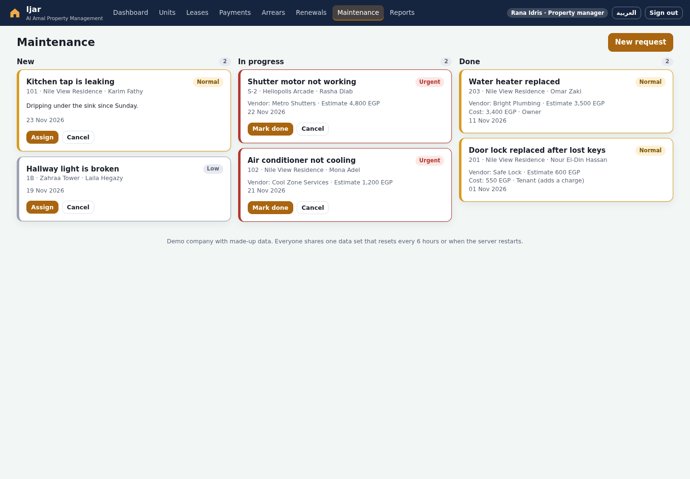
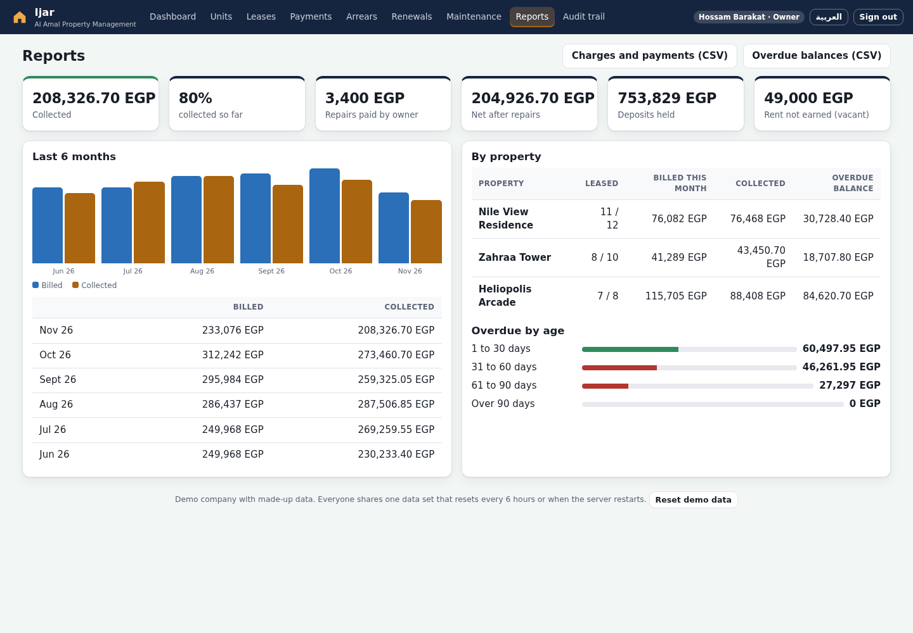
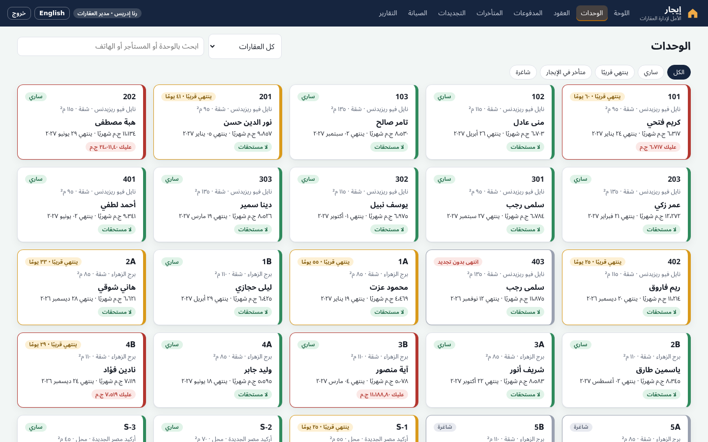

# Ijar (إيجار): rent and tenant management

A bilingual (Arabic RTL / English) system for a small property management company: buildings and units, leases with yearly rent increases, monthly billing, payments with numbered receipts, late fees, arrears by age, renewals, move-out and deposit settlement, repair requests, owner reports, and a tenant portal.

**Live demo:** https://ijar-rent.vercel.app
**Product direction, scope and delivery:** Nada Gamal.



## Try it

Open the demo and sign in with a PIN (the language button switches Arabic / English):

| Role | PIN |
| --- | --- |
| Owner (Hossam) | 1111 |
| Property manager (Rana) | 2222 |
| Accountant (Wael) | 3333 |
| Tenant portal (Karim Fathy) | 4444 |

The demo company manages 3 buildings and 30 units (apartments, shops and one office), 27 leases, 24 tenants, about 200 receipts and 9 months of billing history, all dated relative to today. "Reset demo data" in the footer (owner) restores the seed.

## What it does

- **Monthly billing.** Each lease bills rent (and an optional service fee) on the same day of the month it started. Rent steps up by the lease's yearly increase from month 13. Nothing is billed before it is due or after the lease ends.
- **Payments and receipts.** Cash, bank transfer, cheque and InstaPay with a reference. A payment is allocated to the oldest open charge first. Partial payments leave the rest open. An overpayment becomes credit that pays the next charge. Receipts are numbered (R-00001...), printable, and the latest payment of the day can be voided by the owner or accountant.
- **Late fees.** One 5% fee per unpaid charge after a 5-day grace period, never twice. The owner or manager can waive an unpaid fee with a reason. Backdated leases get no retroactive fees.
- **Arrears.** Overdue balances by age (1 to 30, 31 to 60, 61 to 90, over 90 days), a WhatsApp reminder link with the amount filled in (opens WhatsApp on the staff member's device and logs the reminder), and a CSV export.
- **Leases.** Overlap checks per unit, deposit capped at 3 months of rent, increase cap, start date window. Renewals open 60 days before the end, stack from the next day at a proposed rent, carry the deposit, and can be cancelled before they start.
- **Move-out.** Choose the date, add deductions, optionally take unpaid rent from the deposit, and see the refund. Charges after the move-out date are cancelled. The settlement is kept on the lease.
- **Repairs.** Tenants file requests for their own unit. Managers assign a vendor and close the job with the real cost, charged to the owner or added to the tenant's account. Managers can close jobs up to EGP 5,000; above that needs the owner.
- **Reports.** Billed and collected for 6 months, collection rate, occupancy, rent not earned on vacant units, deposits held, net after repairs, by building.
- **Roles.** Owner sees everything including the audit trail. Manager runs leases, repairs and renewals. Accountant handles money only. A tenant sees only their own lease, statement, receipts and requests.
- **Also.** CSV exports (formulas neutralised), an audit trail, Arabic digits accepted in forms.

All business rules live in `public/logic.js` and are shared by the browser and the API. The seed history is produced by running the same billing and payment code day by day, so the demo ledger always adds up.

## Screenshots

| | |
| --- | --- |
|  |  |
|  |  |
|  |  |
|  |  |

Arabic owner dashboard: `docs/dashboard-ar.png`. Tenant portal on a phone: `docs/tenant-ar-mobile.png`. Arrears on a phone: `docs/arrears-ar-mobile.png`.

## Honest limits

This is a working demo, not a production system.

- The PINs are public and there is no real authentication, password reset or per-company accounts. The tenant portal has one demo login.
- State is held in server memory only. It resets about every 6 hours and whenever the serverless instance restarts. Nothing is stored in a database, and if the host runs more than one instance they could briefly show different data.
- Billing runs when the app loads data, not on a timer. A real deployment needs a scheduled job.
- Tenants cannot pay online. There is no payment gateway, bank feed or cheque clearing. Payments are recorded by staff.
- Reminders open a WhatsApp link on the staff member's device. Nothing is sent automatically, and there is no SMS or email.
- Receipts are internal numbers, not tax invoices. There is no e-invoicing, contract PDF, document upload or e-signature.
- Late fee, grace period, deposit cap and increase cap are demo settings. They are not tied to any rent law, and the app gives no legal advice.
- Rent is billed on the lease start day each month with no pro-rating. Deposits are assumed collected when the lease is created.
- Names, phone numbers, buildings and amounts are invented. One company, one currency (EGP), Cairo time.

## Tests

- `npm test`: 33 unit tests for the business rules (dates, billing, yearly increase, late fees, allocation, credit, void, overlap, deposit, renewal, move-out, waivers, aging, repairs, privacy, reports, CSV).
- `node e2e/e2e.mjs <url>`: 115 browser and API checks against a running copy (needs Chrome at `/usr/bin/google-chrome`). They cover forged tokens, malformed and oversized bodies, every role's permissions, tenant data isolation, payments and receipts, late fees, leases, renewals, move-out, repairs, hostile text, Arabic RTL and phone layout on every page.

```
npm install
npm run dev            # http://localhost:3100
npm test
./run-local.sh node e2e/e2e.mjs http://localhost:3100
```

## Structure

```
public/logic.js   business rules, seed, reports (shared)
public/app.js     the single-page app
public/i18n.js    English and Arabic text
api/data.js       one JSON endpoint (Vercel serverless)
api/_auth.js      signed demo tokens
test/             unit tests
e2e/              browser and API checks, screenshot script
```
